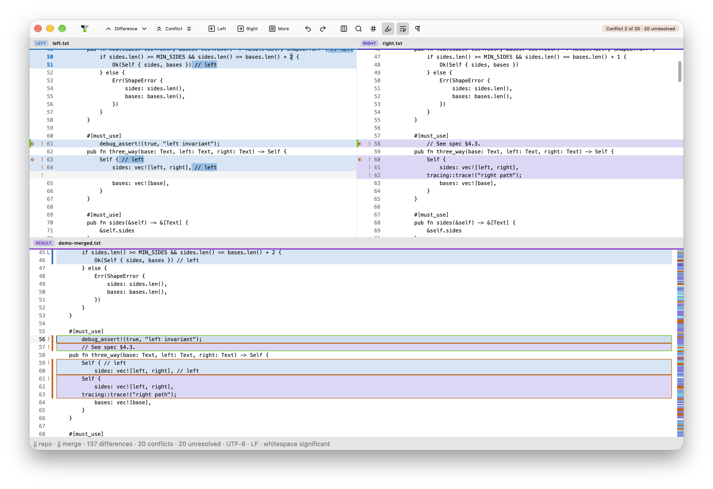

<picture>
  <source media="(prefers-color-scheme: dark)" srcset="images/triad-logo-dark.svg">
  
</picture>

# triad-merge

[](https://github.com/lookbusy1344/triad-merge/actions/workflows/triad.yml)
[](https://github.com/lookbusy1344/triad-merge/actions/workflows/github-code-scanning/codeql)
[](https://github.com/lookbusy1344/triad-merge/actions/workflows/audit.yml)
[](https://crates.io/crates/triad-merge)

triad is a native three-way merge and two-way diff tool, written in Rust and GPUI, built for [Jujutsu](https://github.com/jj-vcs/jj) with full Git support. It opens a million-line merge in under a second, merges as your VCS does, and resolves conflicts straight from the repository. The binary is `triad-merge`.



## Platforms

triad 0.1 is an early beta, tested on macOS 27 on Apple Silicon. [Releases](https://github.com/lookbusy1344/triad-merge/releases) also carry Linux x64 and Windows x64 builds; they pass CI but are untested on real desktops.

## Why triad

- **jj first.** In a jj repository triad merges with jj's rules: jj's diff, its trivial resolution, `merge.same-change`, `merge.hunk-level`, and conflicts of any number of sides.
- **Git parity.** In a git repository triad merges as `git merge-file` does, byte for byte, and reads conflicts from git's index. Every feature git can support works in both.
- **Built on what jj records.** Resolve a conflict in any commit, walk a file through the operation log, absorb edits into the commits that wrote the lines (§ jj-enabled features).
- **Checked semantics.** Two oracle corpora pin the engine: about 1,950 triples from `git merge-file` and 1,970 merges from jj-lib.
- **Fast on large files.** Panes draw only the rows on screen; scrolling holds the display's refresh rate at 1M lines.
- **No git or jj binaries.** triad reads and writes repositories in-process through gix and jj-lib.
- **Scriptable.** A headless mode and `--json` output expose the merge model to scripts, tests and agents.
- **No unsafe code.** The workspace forbids it.

## Features

**Merge window.** Left and right sit side by side, each showing its changes from base; the editable result sits below. Changes on one side, or the same change on both, apply on their own. Resolve each conflict by picking sources in order (left, base, right, or several), by typing in the result, or by taking one side for every conflict left. One undo history covers picks and edits.

**Moved and duplicated code.** A block a side moved shows teal at both ends, with a pill that jumps to the other end. When both sides add the same block in different places, the merge holds it twice without a conflict; triad counts and outlines both copies and offers to drop one.

**Diff window.** Two editable, aligned panes with copy to the other side. Moved blocks show at both ends. `triad-merge diff PATH` compares a working-copy file with its parent revision and saves edits to the working copy.

**Directory diff.** Two directories, a revision against the working copy, `jj diff --tool` or `git difftool -d` open a list of the files that differ, with renames and copies paired as jj pairs them. Each opens in the diff window.

**Resolve from the repository.** `triad-merge resolve` opens each conflicted file in turn, from jj's working-copy commit or git's index. git stages a resolved save; jj records each save as its own operation, which `jj undo` reverts.

**Line origins.** A blame column shows the commit, author and jj change that wrote each line.

**Merge refinements**, all opt-in except the first:

- Conflict refinement trims lines both sides share off the ends of a conflict, as git's `zdiff3` does.
- Word-level merging retries each conflict word by word, as jj's `merge.hunk-level = "word"` does.
- Deep refinement splits shared blocks out of the middle of a conflict.
- Syntax boundaries keep refinements from cutting inside a syntax node.
- Suggestions offer, never apply, resolutions for common shapes: both sides inserting, sorted lists, a block moved on one side and edited on the other, a duplicated block.

**Editor.** Syntax highlighting for Rust, Go, C#, Python, Swift, HTML, JavaScript, TypeScript, TSX, JSON, YAML, TOML, CSS and C. Overview ruler, search and replace, soft wrap, scroll sync, collapsed unchanged regions, whitespace modes, case-insensitive comparison, ignore patterns, line-ending control, recovery journals and a plain-text config file.

**Text.** UTF-8 and UTF-16 with a BOM; any other text reads as Windows-1252 and saves back byte for byte. Invisible and bidirectional characters show as code-point badges, so a Trojan Source trick reads in its true order.

## jj-enabled features

These rest on what jj records, so git has no form of them; in a git repository each exits 3. [`docs/USER-GUIDE.md`](docs/USER-GUIDE.md) §3 shows each command.

- **Conflicts in any commit.** `triad-merge stack` lists the conflicted mutable commits in a window; open any conflicted path from there. `resolve PATH -r REV` resolves in that commit without `jj edit`. A save rewrites the commit and rebases its descendants, and triad asks first when that changes a descendant's conflicts.
- **File history from the operation log.** `triad-merge history PATH` lists each version of a file across jj's snapshots. Open one against the working copy and copy back what you overwrote.
- **Absorb.** `triad-merge absorb` sends each working-copy hunk to the commit that last changed its lines. A window shows where each hunk goes and lets you send it elsewhere or keep it. A hunk that would conflict in its target stays, with the reason.

Each has a form for scripts: `--list`, `--json` or `--headless`.

## Performance

Release build on an M4 Pro, 120 Hz display, plain text. Spec §9 holds the targets; `script/measure-app` and the benchmarks check them.

| Operation | 100k lines | 1M lines | Target, 100k / 1M |
|---|---|---|---|
| Load and merge | 46–50 ms | 521–548 ms | 100 ms / 1 s |
| Command to first frame | 210–223 ms | 727–754 ms | 300 ms / 1.5 s |
| Scrolling, frame interval p95 | 8.4 ms | 8.4 ms | refresh rate |
| Pick a side, max | 0.6 ms | 6.3 ms | 16 ms |
| Keystroke, max | 0.5 ms | 5.2 ms | 8 ms |
| Peak resident memory | 221 MB | 869 MB | 300 MB / 2 GB |

An idle window draws nothing.

## Install

The [crates.io package](https://crates.io/crates/triad-merge) only holds the name: `cargo install triad-merge` does not install triad.

### From a release

Download the archive for your platform from [Releases](https://github.com/lookbusy1344/triad-merge/releases), which lists each file's SHA-256 digest.

- **macOS:** `triad-merge-VERSION-aarch64-apple-darwin.zip` holds `triad.app`, signed ad hoc and not notarised. Clear the quarantine before the first run, `xattr -dr com.apple.quarantine triad.app`, then copy it to `/Applications` and register it as below.
- **Linux:** an AppImage and a `.tar.gz`, for glibc 2.35 or later.
- **Windows:** a zip with `triad-merge.exe`, the console binary that tools call, and `triad-merge-gui.exe`. Neither is signed, so SmartScreen warns on the first run.

### From source on macOS

You need an Apple Silicon Mac on macOS 27 or later, the Xcode Command Line Tools and `rustup`. From the repository root:

```sh
script/macos-app                                                   # builds target/release/triad.app
rm -rf /Applications/triad.app
cp -R target/release/triad.app /Applications/
/Applications/triad.app/Contents/MacOS/triad-merge install --jj    # jj resolve, jj diff --tool triad
/Applications/triad.app/Contents/MacOS/triad-merge install --git   # git mergetool, git difftool
ln -sf /Applications/triad.app/Contents/MacOS/triad-merge ~/.local/bin/triad-merge
```

`install` registers the binary it runs from in jj's user config or git's global config, and leaves other settings alone; `--config FILE` writes elsewhere. Rerun it after moving the binary. The link puts `triad-merge` on your `PATH` and follows each new copy of the app. To update, pull and repeat the first three commands. If an old `triad-merge` shadows the link, `which -a triad-merge` finds it.

## Use

[`docs/USER-GUIDE.md`](docs/USER-GUIDE.md) covers every command, jj first, then git, then plain files.

```sh
jj resolve                               # each conflicted file, in turn
jj diff --tool triad                     # the changed files, in a list
git mergetool                            # each conflicted file; a resolved save is staged
git difftool -d                          # the changed files, in a list
triad-merge resolve                      # the same as jj resolve or git mergetool, without the VCS binary
triad-merge diff src/lib.rs              # a file against its parent; edits save to the working copy
triad-merge diff --rev main              # the changed files against main
triad-merge BASE LEFT RIGHT -o OUTPUT    # a merge of three files
triad-merge diff LEFT RIGHT              # two files or two directories
triad-merge                              # the open dialog
```

triad follows the repository: jj's semantics in a jj repository, git's elsewhere. In a jj repository `git mergetool` exits 3; use `jj resolve`.

Exit codes: 0 all conflicts resolved, 1 conflicts left, 2 cancelled, 3 error.

`fixtures/demo` holds merges and directories to try by hand (`fixtures/demo/README.md`).

### Settings

`~/.config/triad/config.triad`, one `key = value` per line; Settings… (⌘,) opens it. `triad-merge show-config --default --docs` lists every key.

### Known limits

- Under `git mergetool`, a save that leaves conflicts exits 1 and git restores its own copy. Run `git mergetool` again; triad offers to restore the session.
- VoiceOver support is unchecked by ear.

## Report a problem

Rerun with `TRIAD_LOG=debug` and send the command and what you expected, `triad-merge --version`, your OS version, the day's log, and the input files if you can share them. Logs sit in `~/Library/Caches/triad/logs/` on macOS, `~/.cache/triad/logs/` on Linux and `%LOCALAPPDATA%\triad\cache\logs` on Windows. The log names files and paths and holds none of their text.

## Build and test

```sh
cargo build --workspace                                         # target/debug/triad-merge
cargo nextest run --workspace --no-run                          # build the tests
cargo nextest run --workspace -E 'package(merge-core) & test(merge3)'   # filtered; never plain `cargo test`
script/pre-commit                                               # the gate before each commit; under 35 s warm
script/checks                                                   # everything CI runs, with the full suite
script/macos-app dist                                           # target/dist/triad.app, fat LTO, as a release builds it
```

A tag `vX.Y.Z` that matches the workspace version runs `.github/workflows/release.yml`, which builds and publishes the three platforms' packages.

`script/gen-conflict-repo` and `script/gen-jj-repo SCENARIO` build disposable jj repositories to try triad in; `script/test-jj-repos` checks triad in each (`docs/test-repos.md`).

On macOS, Gatekeeper scans each newly linked binary on its first run, so the first test run after a rebuild can stall before any test starts, with `syspolicyd` at full CPU. Add your terminal and IDE under System Settings → Privacy & Security → Developer Tools and restart them. `spctl developer-mode enable-terminal` shows that pane if it is missing.

## Documents

| File | Contents |
|---|---|
| `docs/USER-GUIDE.md` | How to use triad, jj then git |
| `docs/SPEC.md` | Behaviour |
| `docs/PLAN.md` | Status, next steps and open work |
| `docs/DESIGN.md` | Design: reasons, decisions, measurements |
| `AGENTS.md` | Rules for changes, the commit gate and commands |
| `docs/STYLE.md` | UI style |
| `docs/json-schema.md` | JSON output and merge commands |
| `docs/PLAN-diff-editor.md` | The diff editor plan, part H |
| `docs/release-checklist.md` | Manual checks before a release |
| `docs/jj-upgrade.md` | The steps of a jj upgrade |
| `docs/gpui-kit-issues.md`, `docs/gix-issues.md` | UI toolkit and gix problems, and triad's answers |
| `docs/mark-colours.md` | The mark's colour schemes and geometry |
| `docs/scroll-debugging.md` | Trackpad scrolling: failure modes and how to reproduce them |
| `docs/residue.md` | Files triad and its scripts leave behind |
| `docs/test-repos.md` | Scripts that build test repositories, and what they check |
| `fixtures/demo/README.md`, `fixtures/conflict-repo/README.md` | Inputs for trying triad by hand |

## Licence

MIT.
