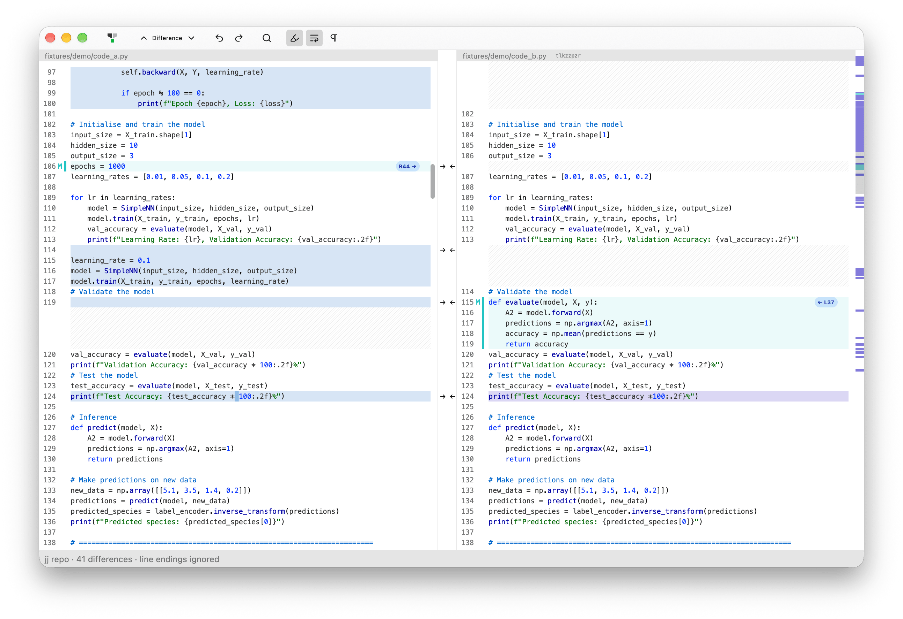
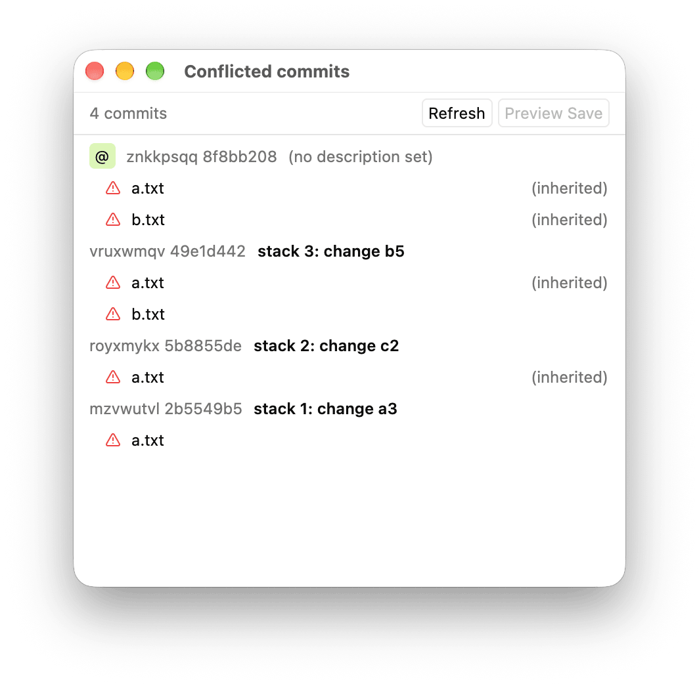

<picture>
  <source media="(prefers-color-scheme: dark)" srcset="images/triad-logo-dark.svg">
  
</picture>

# triad-merge

[](https://github.com/lookbusy1344/triad-merge/releases)
[](https://github.com/lookbusy1344/triad-merge/releases)
[](https://github.com/lookbusy1344/triad-merge/releases)
[](https://github.com/lookbusy1344/triad-merge/releases)

[](https://github.com/lookbusy1344/triad-merge/actions/workflows/triad.yml)
[](https://github.com/lookbusy1344/triad-merge/actions/workflows/github-code-scanning/codeql)
[](https://github.com/lookbusy1344/triad-merge/actions/workflows/audit.yml)

triad is a **fast** native 3-way merge and 2-way diff tool, written in Rust and GPUI, built for [Jujutsu](https://www.jj-vcs.dev/latest/) with full Git support. It runs on macOS, Linux and Windows. It opens a million-line merge x10 faster than VS Code, merges as your VCS does, and resolves conflicts in the repository. The binary is `triad-merge`.


## Status

triad 0.2 is a beta. [Releases](https://github.com/lookbusy1344/triad-merge/releases) carry builds for macOS on Apple Silicon, Linux x64 and Windows x64.

## Why triad

- **Jujutsu first.** In a Jujutsu (jj) repository triad merges with jj's rules. It also resolves conflicts in any commit, walks a file through the operation log and absorbs edits into the commits that wrote the lines (§ Jujutsu-enabled features).
- **Fast.** triad opens a 1M-line merge in 1.3 s. VS Code takes 13–24 s, and turns off highlighting and folding to do it. triad uses a quarter of VS Code's memory at 100k lines and under half at 1M. Scrolling stays smooth at 1M lines (§ Performance).
- **Git parity.** In a git repository triad merges as `git merge-file` does, byte for byte. Every feature git can support works in both.
- **Checked semantics.** Two oracle corpora pin the engine: about 1,970 merges from jj-lib and 1,950 triples from `git merge-file`.
- **No jj or git binaries.** triad reads and writes repositories in-process through jj-lib and gix.
- **Scriptable.** A headless mode and `--json` output expose the merge model to scripts, tests and agents.
- **No unsafe code.** The workspace forbids it.

## Features

**3-way merge.** Left and right sit side by side, each showing its changes from base; the editable result sits below. Changes on one side, or the same change on both, apply on their own. Resolve each conflict by picking sources in order (left, base, right, or several), by clicking a block's `!` in the result's gutter to keep that block's side alone, by typing in the result, or by taking one side for every conflict left. One undo history covers picks and edits.

**Moved and duplicated code.** A block a side moved shows teal at both ends, with a pill that jumps to the other end. When both sides add the same block in different places, the merge holds it twice without a conflict; triad counts and outlines both copies and offers to drop one.

**File diff.** Two editable, aligned panes with copy to the other side. Moved blocks show at both ends. `triad-merge diff PATH` compares a working-copy file with its parent revision and saves edits to the working copy.

The diff window below shows a block moved between the files, with a pill at each end that jumps to the other.



**Directory diff.** Two directories, a revision against the working copy, `jj diff --tool` or `git difftool -d` open a list of the files that differ, with renames and copies paired as jj pairs them. Each opens in the diff window.

**Resolve from the repository.** `triad-merge resolve` opens each conflicted file in turn, from jj's working-copy commit or git's index. git stages a resolved save; jj records each save as its own operation, which `jj undo` reverts.

**Line origins.** A blame column shows the commit, author and jj change that wrote each line.

**Merge refinements**, all opt-in except the first:

- Conflict refinement trims lines both sides share off the ends of a conflict, as git's `zdiff3` does.
- Word-level merging retries each conflict word by word, as jj's `merge.hunk-level = "word"` does.
- Deep refinement splits shared blocks out of the middle of a conflict.
- Syntax boundaries keep refinements from cutting inside a syntax node.
- Suggestions offer, never apply, resolutions for common shapes: both sides inserting, sorted lists, a block moved on one side and edited on the other, a duplicated block.

**Editor.** Syntax highlighting for Rust, Go, C, C++, C#, Python, Swift, Java, Kotlin, HTML, JavaScript, TypeScript, TSX, JSON, YAML, TOML, CSS, Markdown, Bash and Zig, by file extension or a script's `#!` line. Overview ruler, search and replace, soft wrap, scroll sync, collapsed unchanged regions, visible whitespace in every pane, comparison that ignores whitespace or case, ignore patterns, line-ending control, recovery journals and a plain-text config file.

**14 languages.** English, Spanish, simplified Chinese, traditional Chinese, Japanese, Korean, German, French, Brazilian Portuguese, Ukrainian, Polish, Dutch, Swedish and Russian. The windows follow the system's language, or `ui-language` in the config file. The command line stays in English.

**Text.** UTF-8, and UTF-16 with a BOM; any other text reads as Windows-1252 and saves back byte for byte. Invisible and bidirectional characters show as code-point badges, so a Trojan Source trick reads in its true order.

## Jujutsu-enabled features

These rely on jj features missing from git; in a git repository each exits 3. [`docs/USER-GUIDE.md`](docs/USER-GUIDE.md) §3 shows each command.

- **Conflicts in any commit.** `triad-merge stack` lists the conflicted mutable commits in a window; open any conflicted path from there. `resolve PATH -r REV` resolves in that commit without `jj edit`. A save rewrites the commit and rebases its descendants, and triad asks first when that changes a descendant's conflicts.
- **File history from the operation log.** `triad-merge history PATH` lists each version of a file across jj's snapshots. Open one against the working copy and copy back what you overwrote.
- **Absorb.** `triad-merge absorb` sends each working-copy hunk to the commit that last changed its lines. A window shows where each hunk goes and lets you send it elsewhere or keep it. A hunk that would conflict in its target stays, with the reason.

Each has a form for scripts: `--list`, `--json` or `--headless`.

The stack window lists each conflicted commit and its conflicted files; an inherited conflict comes from an ancestor.



## Performance

Release build on a Mac M4 Pro, 120 Hz display, plain text. [Spec](docs/SPEC.md) §9 holds the targets; `script/measure-app` and the benchmarks check them.

| Operation | 100k lines | 1M lines | Target, 100k / 1M |
|---|---|---|---|
| Load and merge | 46–50 ms | 521–548 ms | 100 ms / 1 s |
| Command to first frame | 210–223 ms | 727–754 ms | 300 ms / 1.5 s |
| Scrolling, frame interval p95 | 8.4 ms | 8.4 ms | refresh rate |
| Pick a side, max | 0.6 ms | 6.3 ms | 16 ms |
| Keystroke, max | 0.5 ms | 5.2 ms | 8 ms |
| Peak resident memory | 221 MB | 869 MB | 300 MB / 2 GB |

An idle window draws nothing.

### Against VS Code

The same merges in VS Code 1.147's merge editor, with extensions off, on the same machine. Open time runs from launch until the app goes idle. Memory covers all of each app's processes.

| | 100k lines, 261 conflicts | 1M lines, 2537 conflicts |
|---|---|---|
| triad, open | 0.3–1.4 s | 1.3 s |
| VS Code, open | 4.4–5.8 s | 13–24 s |
| triad, memory | 296 MB | 890 MB |
| VS Code, memory | 1.2 GB | 2.2–2.3 GB |

At 1M lines VS Code turns off syntax highlighting to cope; triad keeps it on.

## Install

triad ships as release binaries and builds from source; it is not distributed through crates.io. The `triad-merge` crate there only holds the name, so `cargo install triad-merge` does not install triad.

### From a release

Download the archive for your platform from [Releases](https://github.com/lookbusy1344/triad-merge/releases).

- **macOS:** `triad.app`, signed ad hoc and not notarised. Clear the quarantine with `xattr -dr com.apple.quarantine triad.app`, copy it to `/Applications`, then run the `install` and `ln` lines below.
- **Linux:** an AppImage or a `.tar.gz`, for glibc 2.35 or later.
- **Windows:** `triad-merge.exe`, which tools call, and `triad-merge-gui.exe`. Both are unsigned, so SmartScreen warns on the first run.

### From source (macOS)

You need an Apple Silicon Mac on macOS 27 or later, the Xcode Command Line Tools and `rustup`. From the repository root:

```sh
script/macos-app                                                   # builds target/release/triad.app
rm -rf /Applications/triad.app
cp -R target/release/triad.app /Applications/
/Applications/triad.app/Contents/MacOS/triad-merge install --jj    # jj resolve, jj diff --tool triad
/Applications/triad.app/Contents/MacOS/triad-merge install --git   # git mergetool, git difftool
ln -sf /Applications/triad.app/Contents/MacOS/triad-merge ~/.local/bin/triad-merge
```

`install` registers the binary it runs from in jj's user config or git's global config, and leaves other settings alone; `--config FILE` writes elsewhere. Rerun it after moving the binary. The link puts `triad-merge` on your `PATH` and follows each new copy of the app. To update, pull and repeat the first three commands. If an old `triad-merge` shadows the link, `which -a triad-merge` finds it.

## Use

[`docs/USER-GUIDE.md`](docs/USER-GUIDE.md) covers every command, jj first, then git, then plain files.

```sh
jj resolve                               # each conflicted file, in turn
jj diff --tool triad                     # the changed files, in a list
git mergetool                            # each conflicted file; a resolved save is staged
git difftool -d                          # the changed files, in a list
triad-merge resolve                      # the same as jj resolve or git mergetool, without the VCS binary
triad-merge diff src/lib.rs              # a file against its parent; edits save to the working copy
triad-merge diff --rev main              # the changed files against main
triad-merge BASE LEFT RIGHT -o OUTPUT    # a merge of three files
triad-merge diff LEFT RIGHT              # two files or two directories
triad-merge                              # the open dialog
```

triad follows the repository: jj's semantics in a jj repository, git's elsewhere. In a jj repository `git mergetool` exits 3; use `jj resolve`.

Exit codes: 0 all conflicts resolved, 1 conflicts left, 2 cancelled, 3 error.

`fixtures/demo` holds merges and directories to try by hand ([`fixtures/demo/README.md`](fixtures/demo/README.md)).

## Code size

About 91,000 lines of Rust in `crates/`, blank lines and comments excluded, as `script/code-size` counts them. Tests make up more than half.

| Part | Lines |
|---|---|
| Product code | 36,000 |
| Tests: `tests/`, `#[cfg(test)]` modules and test-support modules | 53,000 |
| Benchmarks and examples | 2,000 |

The GPUI shell, `merge-app`, holds 15,000 lines of product code; `merge-core` holds 5,000. `vendor/gpui-base` is left out.

## Documents

| File | Contents |
|---|---|
| [`docs/USER-GUIDE.md`](docs/USER-GUIDE.md) | How to use triad, jj then git |
| [`docs/DEVELOPMENT.md`](docs/DEVELOPMENT.md) | How to build and test triad |
| [`docs/SPEC.md`](docs/SPEC.md) | Behaviour |
| [`docs/PLAN.md`](docs/PLAN.md) | Status, next steps and open work |
| [`docs/DESIGN.md`](docs/DESIGN.md) | Design: reasons, decisions, measurements |
| [`AGENTS.md`](AGENTS.md) | Rules for changes, the commit gate and commands |
| [`docs/STYLE.md`](docs/STYLE.md) | UI style |
| [`docs/json-schema.md`](docs/json-schema.md) | JSON output and merge commands |
| [`docs/PLAN-diff-editor.md`](docs/PLAN-diff-editor.md) | The diff editor plan, part H |
| [`CHANGELOG.md`](CHANGELOG.md) | What changed in each release |
| [`docs/release.md`](docs/release.md) | The steps of a release |
| [`docs/release-checklist.md`](docs/release-checklist.md) | Manual checks before a release |
| [`docs/jj-upgrade.md`](docs/jj-upgrade.md) | The steps of a jj upgrade |
| [`docs/gpui-kit-issues.md`](docs/gpui-kit-issues.md), [`docs/gix-issues.md`](docs/gix-issues.md) | UI toolkit and gix problems, and triad's answers |
| [`docs/mark-colours.md`](docs/mark-colours.md) | The mark's colour schemes and geometry |
| [`docs/scroll-debugging.md`](docs/scroll-debugging.md) | Trackpad scrolling: failure modes and how to reproduce them |
| [`docs/residue.md`](docs/residue.md) | Files triad and its scripts leave behind |
| [`docs/test-repos.md`](docs/test-repos.md) | Scripts that build test repositories, and what they check |
| [`docs/human-testing.md`](docs/human-testing.md) | Testing by hand, step by step: diff, merge and the jj features, with the output to expect |
| [`fixtures/demo/README.md`](fixtures/demo/README.md), [`fixtures/conflict-repo/README.md`](fixtures/conflict-repo/README.md) | Inputs for trying triad by hand |

## Licence

MIT.
